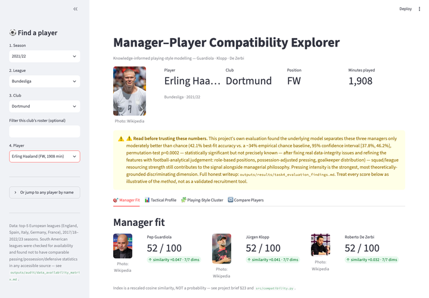
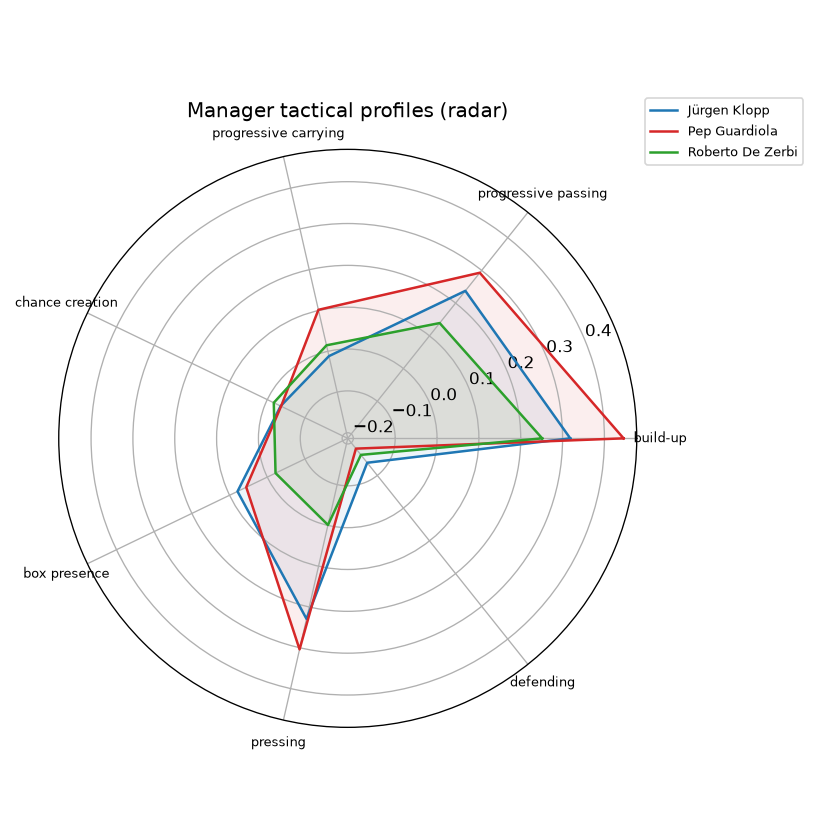
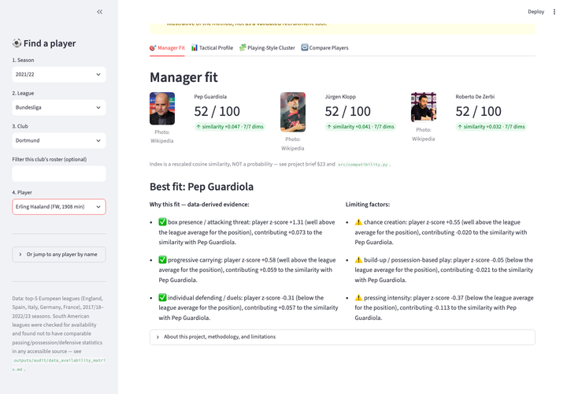

# AI Applied to Football — Knowledge-Informed Playing Style Modelling & Explainable Manager–Player Compatibility

> **Can a model measure whether a player "fits" Guardiola's, Klopp's or De Zerbi's playing style?**
> This project builds an explainable answer from football knowledge and open data, and reports honestly how well it works.

MIAD final project (Master in Artificial Intelligence Applied to Sports, Sports Data Campus / UCAM), graded **97.2/100**.

**Live app: [football-player-fit.streamlit.app](https://football-player-fit.streamlit.app)**

<p align="center">
  
</p>

## At a glance

- **Football knowledge layer, built by hand:** FBref/Opta stats → 10 game concepts → 7 tactical dimensions, anchored on a published playing-style taxonomy (Plakias et al. 2025).
- **11,132 player-seasons** from the big-5 leagues (2017/18 to 2022/23), z-scored by role.
- **Every match attributed to the manager in charge on that date**, not that season (e.g. Klopp replaced Rodgers after 8 league games; De Zerbi replaced Potter after 4).
- **Explainable compatibility:** cosine similarity between a player and each manager profile, broken down per tactical dimension in football language.
- **Result:** 42.1% best-fit rate vs ~34% by chance (95% CI 37.8 to 46.2%, permutation p = 0.0002). Better than chance, far from decisive, and reported as such.
- **Pressing intensity** is by far the strongest signal. Adjusted for possession, Guardiola's teams press marginally *more* than Klopp's.
- **Method lesson:** the first result looked too clean. Two data bugs (fake zeros for missing data, a Serie A/Ligue 1 coverage gap) were found and fixed, which dropped the result to chance level (32.8%) before analyst-driven refinements brought it to 42.1%. Full trail in [`decision_log.md`](decision_log.md).

## Screenshots

| Manager profiles (radar) | Explainable score in football language |
|---|---|
|  |  |

## Run the app
```bash
.venv/bin/streamlit run app/streamlit_app.py
```

MIAD (Máster en Inteligencia Artificial Aplicada al Deporte) final project. Models the playing philosophies of Pep Guardiola, Jürgen Klopp and Roberto De Zerbi as measurable football dimensions, builds player profiles, and computes explainable player→manager compatibility. Developed with CRISP-DM as the mandatory methodological framework.

Browse any player from the top-5 European leagues (2017/18–2022/23), see their compatibility with Guardiola/Klopp/De Zerbi's playing philosophies with a football-language explanation, compare against other players, and see where they sit among data-driven playing-style clusters. The app surfaces this project's own honest limitations prominently (see `outputs/results/task4_evaluation_findings.md`) — it is a research demonstration, not a validated recruitment tool.

**Start here:** [`report/memoria.md`](report/memoria.md) — the full academic report (3-escalón/CRISP-DM structure). For the raw research trail: [`outputs/PHASE0_DELIVERABLE.md`](outputs/PHASE0_DELIVERABLE.md) (initial methodology) and [`outputs/results/task4_evaluation_findings.md`](outputs/results/task4_evaluation_findings.md) (the honest evaluation result).

## The pipeline in one paragraph

Raw FBref/Opta match and season stats (`data/raw/`) are attributed to Guardiola/Klopp/De Zerbi via verified match-date tenure windows (`notebooks/02`, `src/manager_attribution.py`) → converted into 9 football concepts and 7 tactical dimensions, z-scored against a full big-5-league population baseline per position group (`notebooks/03`, `src/football_features.py`) → scored for compatibility against each manager's centroid via cosine similarity, with per-dimension contribution explanations and a club-identity-bias check (`notebooks/04`, `src/compatibility.py`) → season-level data restores De Zerbi's Sassuolo years and builds the full player universe (`notebooks/05`) → k-means playing-style clusters and all figures (`notebooks/06`) → the Streamlit app (`app/`) serves it all. Headline result: 42.1% best-fit match rate (vs ~33% chance), with pressing intensity as the only robust discriminator — see `outputs/results/task4_evaluation_findings.md`.

## Structure — what each folder and file is

### Root
| File | What it is |
|---|---|
| `README.md` | This file: project overview, how to run the app, repo map |
| `project_plan.md` | Living plan: objective, completed work, current decision point, next tasks, risks, deadline |
| `decision_log.md` | 10 numbered decisions (D-001…D-010) with alternatives, evidence and consequences — e.g. match-level attribution (D-004), the Serie A/Ligue 1 coverage gap found and fixed (D-006), analyst-driven refinements (D-007), and corrections of earlier claims (D-009/D-010) |
| `data_dictionary.md` | Every raw source column, engineered concept, tactical dimension, and evaluation statistic documented |
| `requirements.txt` | Pinned dependencies: Jupyter, pandas, numpy, scikit-learn, plotly, streamlit, soccerdata, pyreadr, etc. |

> **Not included in this public repository:** the programme guidelines and the academic papers used as references (the papers are listed in the bibliography under `report/`), and the raw FBref/Opta and StatsBomb data files, which belong to their providers. The raw data is not needed to run the app: the processed outputs are included. To rebuild it, `src/data_sources.py` and `notebooks/02` download it from the original sources, under their terms of use.

### `data/` — the CRISP-DM data stages
- **`raw/`** (not in this repo, see above) — FBref match-level player stats for ENG/FRA/ITA (7 stat blocks each, 2017/18–2025/26), FBref season-level big-5 tables (used where match-level data does not exist, D-006, and for possession-adjusted pressing), and StatsBomb Open Data manifests (used only to cross-validate manager attribution, never pooled with the FBref source, D-003).
- **`external/`** — `manager_tenures.csv` + `manager_tenures.md`: the verified, source-corroborated tenure ground truth (incl. mid-season splits) that drives all attribution.
- **`processed/`** — 9 parquet pipeline outputs: `player_match_manager` (attributed player×match), `player_manager_season`, `population_baseline` + `season_population_baseline` (league-wide z-score baselines), `player_profiles` / `manager_profiles` (tactical-dimension vectors), `player_manager_compatibility` + `universe_compatibility` (scores), `player_universe` (all big-5 players ≥450 min, with clusters).
- **`interim/`** — empty scaffold (never needed).

### `notebooks/` — the CRISP-DM pipeline (02–06)
| Notebook | Role |
|---|---|
| `02_data_collection_and_manager_attribution` | Downloads/caches FBref CSVs, merges 7 stat blocks, attributes every player-match to a manager via verified date windows, passes the integrity audit (zero out-of-window rows, zero duplicates) |
| `03_football_feature_engineering` | The "Football Knowledge Layer": raw metrics → 9 concepts → 7 tactical dimensions, position-group-aware z-scoring against the full league population, PCA coherence checks, manager profiles |
| `04_player_manager_compatibility` | Cosine-similarity scoring vs manager centroids, contribution-based explanations, club-identity-bias check (where the `fillna(0)` bug and coverage gap were found), bootstrap/permutation significance, formation analysis |
| `05_season_level_integration` | v2 patch: uses season-level data to restore De Zerbi's Sassuolo years and build the full big-5 player universe; adds a season-only pressing term |
| `06_clustering_and_visualization` | k-means playing-style clusters (k=5) with validity indices (silhouette/Davies-Bouldin/Calinski-Harabasz), football-language cluster labels, all figures for the app |

### `src/` — the reusable pipeline code (notebooks call these)
- `data_sources.py` — download/cache layer for FBref CSVs + StatsBomb manifests; all path constants
- `manager_attribution.py` — hard-coded verified tenure windows, stat-block merging, integrity audit
- `football_features.py` — the ontology engine: 8-way role grouping, 10 concepts, explicit dimension weights, population baseline, NaN-aware aggregation, player/manager/club profiles
- `season_features.py` — season-level merge machinery, safe whole-season tenures, pressing-term injection
- `compatibility.py` — masked cosine similarity, 0–100 index, per-dimension contribution explanations

### `outputs/` — research deliverables
- `PHASE0_DELIVERABLE.md` — initial methodology + open decisions OD-1…OD-6
- `literature/literature_review_synthesis.md` — synthesis of the 7 supplied papers
- `football_knowledge/football_ontology.md` — the published 19-dimension ontology (Plakias et al. 2025) + this project's 7-dimension adaptation; `manager_philosophy_hypotheses.md` — falsifiable hypotheses per manager (stable vs contingent traits)
- `audit/data_availability_matrix.md` — what data exists per manager×club×season (incl. the proven data-non-existence of the Bayern/Dortmund eras); `integrity_audit.md` — the clean attribution audit
- `results/task4_evaluation_findings.md` — the honest evaluation: bugs found/fixed, 32.8%→37.8%→42.1% progression, limitations
- `tables/` — 12 CSVs of model outputs (cluster profiles/labels/validity, club-bias matrices, permutation importance, significance test, formation profiles)
- `figures/` — 5 PNGs (manager radar/bar, PCA clusters, compatibility distributions, cluster validity)

### `app/` — the deployed product
- `streamlit_app.py` — "Manager–Player Compatibility Explorer": browse any big-5 player, see fit vs the 3 managers with explanations, radar profile, cluster position, player comparison; surfaces the project's limitations prominently
- `images.py` — best-effort player/manager photo lookup via the Wikipedia REST API (returns None and shows a placeholder rather than guessing an image)

### `report/` — the academic deliverables
- `memoria.md` / `memoria.pdf` — the full academic memoria (3-escalón, CRISP-DM structure); `final_report.md` / `final_report.pdf` — the polished report version (`.bak` files are pre-final backups)
- `bibliography.md` / `bibliography.pdf` — citations
- `video_script.md` — CRISP-DM video script (scene-by-scene, with final verified numbers and recording instructions)
- `assets/` — LaTeX covers (`cover_*.tex`; the manager photos they use are not included), shared styling (`header.tex`), app screenshots of the Haaland worked example (`screenshots/`), and two figure scripts (`make_report_figures.py` Plotly / `make_report_figures_mpl.py` Matplotlib fallback) that regenerate the report's app figures to match the live app exactly

### Config / scaffolding
- `.streamlit/config.toml` — dark theme with gold accent for the app
- `models/`, `dashboard/` — empty scaffolds (clustering is refit in notebook 06 rather than persisted; the dashboard idea was superseded by `app/`)
- `.venv/` — the virtual environment (gitignored)

## Environment
```bash
python3 -m venv .venv
.venv/bin/pip install -r requirements.txt
```
